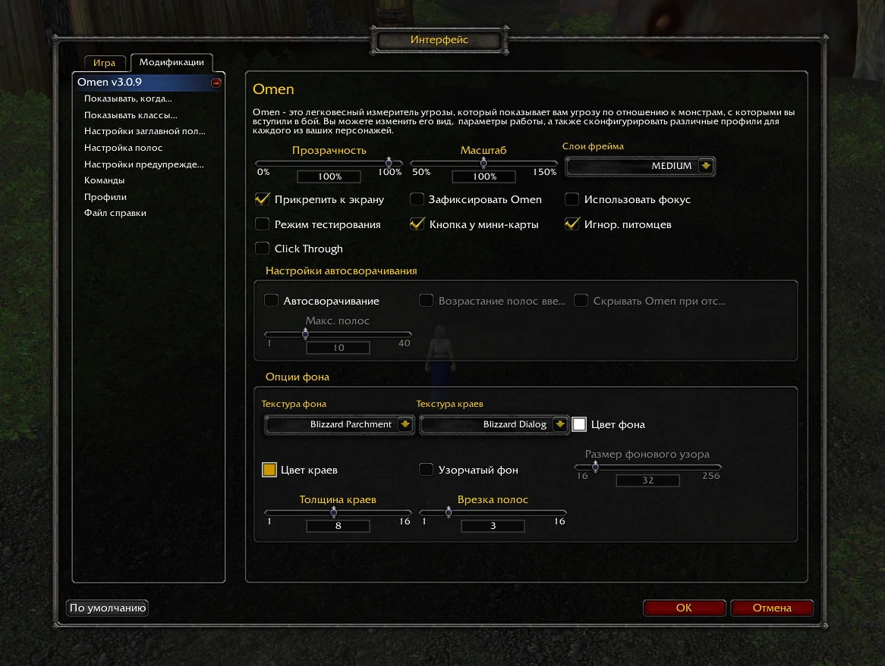
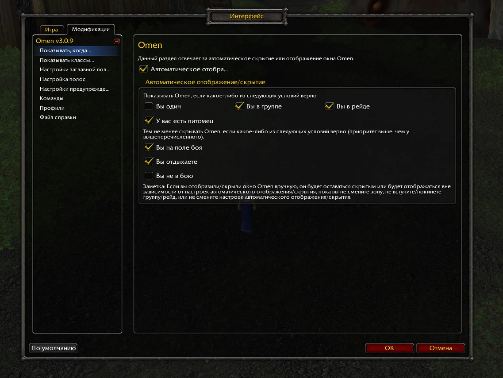
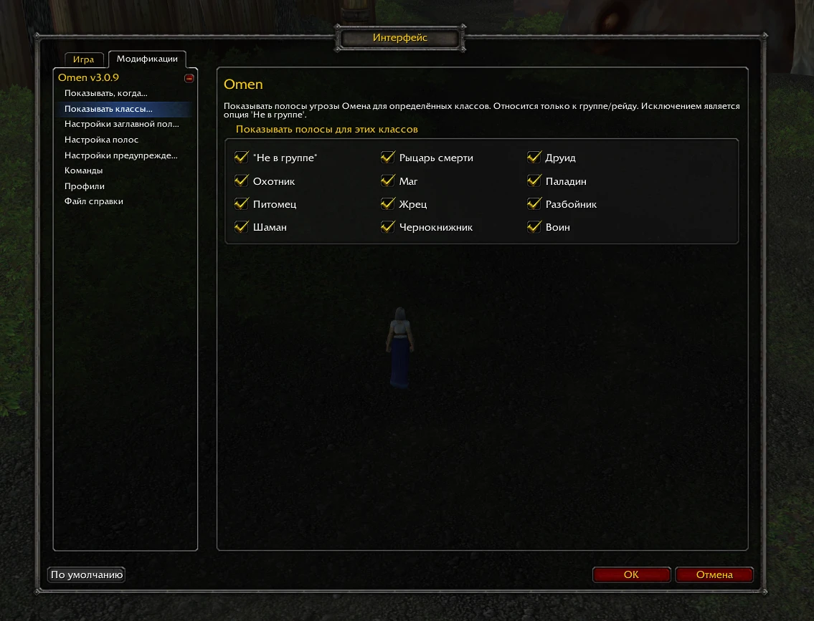
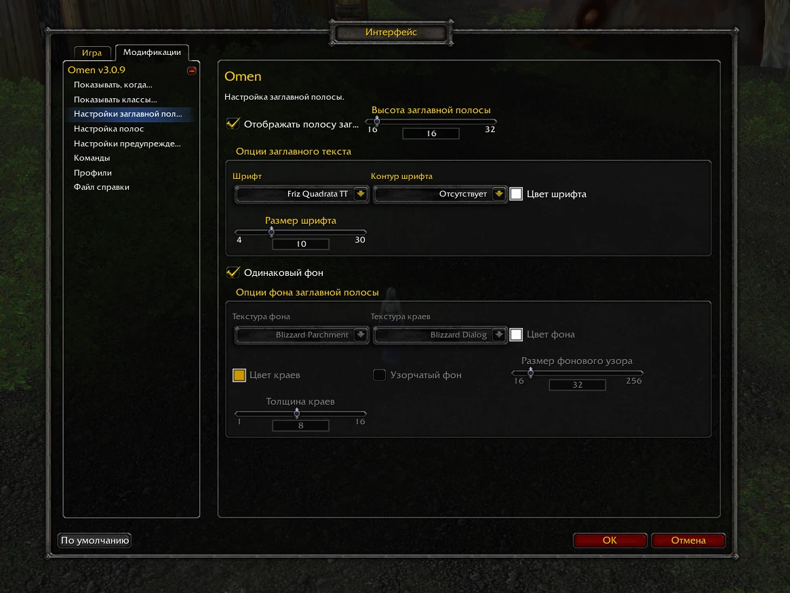
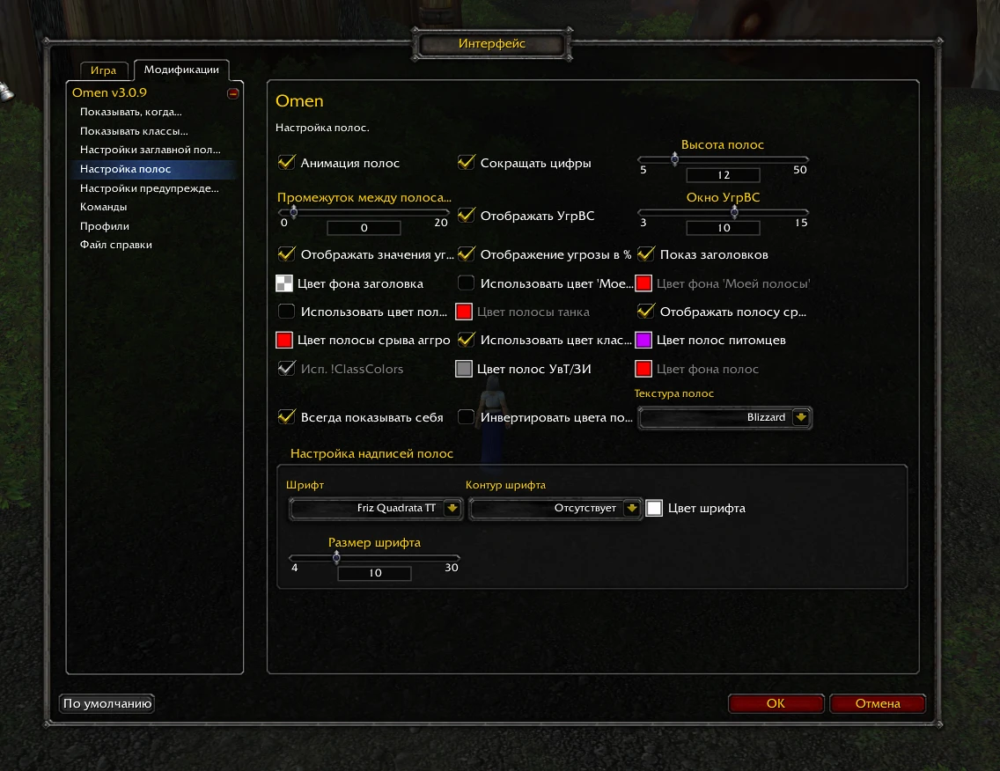
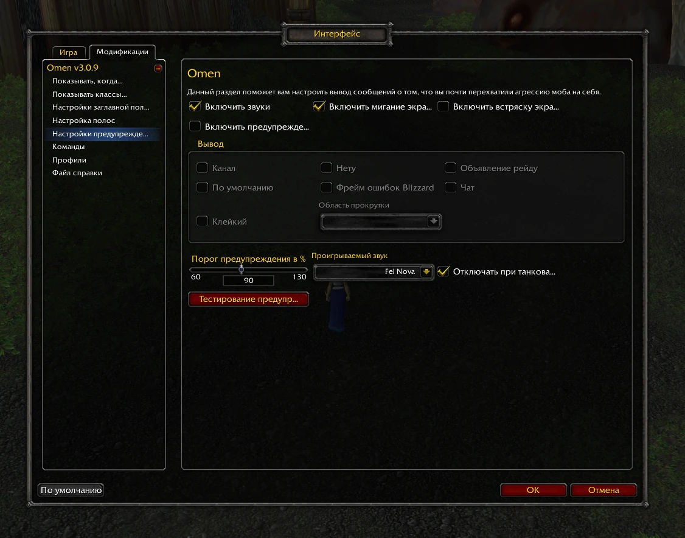

**Omen** - это очень удобная модификация, которая будет полезна в рейдах. Основное назначение - слежение за своим аггро. Отображает аггро игрока и участников группы, что позволяет вовремя подсказать другим о том, что босс может сорваться на них.

Особенности:
- Возможность выбрать каждого отдельного монстра для просмотра уровня агро на нем;
- Гибкие настройки аддона.

Настройка:\
ESC -> Интерфейс -> Модификации -> Omen - окно настройки.

**Скриншоты:**

